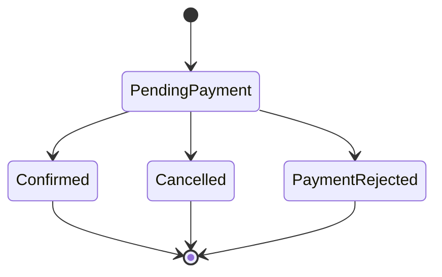

# Escopo do Projeto - OrderFlow

## Visão Geral

OrderFlow é uma API backend para gerenciamento de pedidos, estoque e pagamentos simulados.

O objetivo do projeto é praticar desenvolvimento backend com .NET em um cenário próximo de aplicações reais, evoluindo gradualmente de uma API simples para um sistema com regras de negócio, persistência, testes, mensageria, processamento assíncrono e preocupações de produção.

## Objetivo de Aprendizado

Este projeto será usado para estudar e praticar:

- ASP.NET Core Web API
- Entity Framework Core
- PostgreSQL
- Docker e Docker Compose
- Testes unitários
- Testes de integração com banco real
- Organização em camadas
- Regras de domínio
- Transações
- Mensageria com RabbitMQ e MassTransit
- Workers em background
- Idempotência
- Outbox pattern
- Logs, health checks e observabilidade

## Produto Final Esperado

Ao final do projeto, o OrderFlow deve permitir:

- Gerenciar produtos
- Controlar estoque
- Criar pedidos
- Reservar estoque ao criar pedidos
- Cancelar pedidos
- Simular pagamentos aprovados ou rejeitados
- Processar eventos de pedidos de forma assíncrona
- Executar testes automatizados com banco real
- Rodar localmente com Docker
- Expor documentação da API
- Ter estrutura clara para leitura e manutenção

## Princípios do Projeto

- Começar simples e evoluir em fases.
- Priorizar clareza antes de abstrações avançadas.
- Evitar microsserviços no início.
- Implementar o fluxo principal antes de mensageria.
- Usar banco real nos testes de integração.
- Manter o projeto útil como portfólio técnico.
- Documentar decisões importantes ao longo do desenvolvimento.

## Escopo Inicial

A primeira versão deve focar no fluxo principal:

1. Criar produtos
2. Registrar estoque para produtos
3. Criar pedidos com itens
4. Validar disponibilidade em estoque
5. Reservar estoque ao criar pedido
6. Cancelar pedido
7. Liberar estoque reservado ao cancelar pedido

## Fora do Escopo Inicial

Os itens abaixo não fazem parte do MVP:

- Autenticação
- Autorização por roles
- RabbitMQ
- MassTransit
- Workers
- Pagamentos
- Outbox pattern
- Idempotência avançada
- Observabilidade avançada
- Frontend
- Microsserviços

Esses itens serão adicionados em fases posteriores, depois que o fluxo principal estiver funcionando.

## Entidades Principais

### Product

Representa um produto disponível para venda.

Campos iniciais:

| Campo | Descrição |
|---|---|
| Id | Identificador do produto |
| Name | Nome do produto |
| Description | Descrição do produto |
| Price | Preço atual |
| IsActive | Indica se o produto pode ser vendido |
| CreatedAt | Data de criação |

### InventoryItem

Representa o estoque de um produto.

Campos iniciais:

| Campo | Descrição |
|---|---|
| Id | Identificador do registro de estoque |
| ProductId | Produto relacionado |
| Quantity | Quantidade física total em estoque |
| ReservedQuantity | Quantidade reservada em pedidos |
| AvailableQuantity | Quantidade calculada por `Quantity - ReservedQuantity` |
| CreatedAt | Data de criação do registro |
| UpdatedAt | Data da última atualização |

### Order

Representa um pedido realizado.

Campos iniciais:

| Campo | Descrição |
|---|---|
| Id | Identificador do pedido |
| Status | Status atual do pedido |
| TotalAmount | Valor total do pedido |
| CreatedAt | Data de criação |
| CancelledAt | Data de cancelamento, se houver |

### OrderItem

Representa um item dentro de um pedido.

Campos iniciais:

| Campo | Descrição |
|---|---|
| Id | Identificador do item |
| OrderId | Pedido relacionado |
| ProductId | Produto comprado |
| Quantity | Quantidade comprada |
| UnitPrice | Preço unitário no momento da compra |
| TotalPrice | Valor total do item |

## Status de Pedido

Estados iniciais:

| Status | Descrição |
|---|---|
| PendingPayment | Pedido criado e aguardando pagamento |
| Confirmed | Pedido confirmado após pagamento aprovado |
| Cancelled | Pedido cancelado |
| PaymentRejected | Pedido com pagamento rejeitado |

Fluxo esperado:



## Regras de Negócio

### Produtos

- Produto inativo não pode ser vendido.
- Produto deve ter nome.
- Produto deve ter preço maior que zero.
- Produto pode ser desativado, mas não deve ser removido fisicamente no primeiro momento.

### Estoque

- Um produto deve ter no máximo um registro de estoque.
- Estoque disponível não pode ficar negativo.
- Estoque reservado não pode ficar negativo.
- Não deve ser possível reservar mais itens do que a quantidade disponível.
- Ao reservar estoque, a quantidade disponível diminui e a quantidade reservada aumenta.
- Ao liberar estoque reservado, a quantidade reservada diminui e a disponível aumenta.

### Pedidos

- Pedido não pode ser criado sem itens.
- Pedido não pode ser criado com quantidade menor ou igual a zero.
- Pedido não pode ser criado se algum produto não existir.
- Pedido não pode ser criado se algum produto estiver inativo.
- Pedido não pode ser criado se não houver estoque suficiente.
- Ao criar um pedido, o estoque deve ser reservado.
- O valor total do pedido deve ser calculado com base no preço dos produtos no momento da compra.
- Cancelar um pedido deve liberar o estoque reservado.
- Pedido confirmado não pode ser cancelado pelo fluxo comum.
- Pedido cancelado não pode ser cancelado novamente.

### Pagamentos

Regras planejadas para fase posterior:

- Pagamento aprovado deve confirmar o pedido.
- Pagamento rejeitado deve marcar o pedido como rejeitado.
- Pagamento rejeitado deve liberar o estoque reservado.
- Um pedido já confirmado não pode receber novo pagamento.
- Um pedido cancelado não pode receber pagamento.

## Endpoints do MVP

### Produtos

```http
POST /products
GET /products
GET /products/{id}
PATCH /products/{id}/price
PATCH /products/{id}/status
```

### Estoque

```http
POST /inventory/items
POST /inventory/items/{productId}/increase
GET /inventory/items/{productId}
```

### Pedidos

```http
POST /orders
GET /orders/{id}
POST /orders/{id}/cancel
```

## Endpoints Planejados

### Autenticação

```http
POST /auth/register
POST /auth/login
```

### Pagamentos

```http
POST /payments/{orderId}/approve
POST /payments/{orderId}/reject
```

### Relatórios

```http
GET /reports/sales
GET /reports/products/top-selling
```

## Estrutura Inicial da Solução

```txt
OrderFlow.Api
OrderFlow.Application
OrderFlow.Domain
OrderFlow.Infrastructure
OrderFlow.Tests
```

## Estrutura Planejada

```txt
OrderFlow.Api
OrderFlow.Application
OrderFlow.Domain
OrderFlow.Infrastructure
OrderFlow.Contracts
OrderFlow.Worker
OrderFlow.Tests
```

## Responsabilidade das Camadas

| Projeto | Responsabilidade |
|---|---|
| OrderFlow.Api | Endpoints, configuração da aplicação, autenticação futura, OpenAPI + Scalar |
| OrderFlow.Application | Casos de uso, DTOs, validações de aplicação |
| OrderFlow.Domain | Entidades, regras de domínio, enums e comportamentos principais |
| OrderFlow.Infrastructure | EF Core, PostgreSQL, repositórios, integrações externas |
| OrderFlow.Contracts | Contratos de eventos e mensagens |
| OrderFlow.Worker | Processamento assíncrono e consumers |
| OrderFlow.Tests | Testes unitários e de integração |

## Roadmap de Desenvolvimento

### Fase 1 - Fundação

- Criar solução .NET
- Criar projetos principais
- Configurar PostgreSQL com Docker Compose
- Configurar EF Core
- Configurar migrations
- Configurar OpenAPI + Scalar
- Criar endpoint de health check

### Fase 2 - Produtos

- Criar entidade Product
- Criar endpoints de produto
- Criar persistência com EF Core
- Criar validações básicas
- Criar primeiros testes

### Fase 3 - Estoque

- Criar entidade InventoryItem
- Criar endpoints de estoque
- Implementar entrada de estoque
- Impedir estoque negativo
- Testar regras de estoque

### Fase 4 - Pedidos

- Criar entidades Order e OrderItem
- Criar endpoint de criação de pedido
- Validar produtos e estoque
- Reservar estoque dentro da criação do pedido
- Calcular total do pedido
- Persistir pedido e itens

### Fase 5 - Cancelamento

- Implementar cancelamento de pedido
- Liberar estoque reservado
- Impedir cancelamento inválido
- Testar cancelamento e liberação de estoque

### Fase 6 - Testes de Integração

- Configurar Testcontainers com PostgreSQL
- Testar criação de produto
- Testar entrada de estoque
- Testar criação de pedido
- Testar pedido com estoque insuficiente
- Testar cancelamento de pedido

### Fase 7 - Pagamentos

- Simular pagamento aprovado
- Simular pagamento rejeitado
- Atualizar status do pedido
- Liberar estoque em caso de rejeição
- Testar fluxo de pagamento

### Fase 8 - Mensageria

- Adicionar RabbitMQ
- Adicionar MassTransit
- Publicar eventos de pedido
- Criar worker para processar eventos
- Adicionar retries básicos

### Fase 9 - Produção

- Adicionar logs estruturados
- Adicionar health checks completos
- Adicionar idempotência
- Adicionar outbox pattern
- Adicionar observabilidade com .NET Aspire

## Fluxo de Trabalho por Feature

Para cada nova funcionalidade, seguir este processo:

1. Entender o comportamento esperado
2. Listar regras de negócio
3. Definir endpoints e payloads
4. Modelar entidades ou ajustar entidades existentes
5. Implementar o caso de uso
6. Persistir os dados
7. Adicionar testes
8. Refatorar se necessário
9. Atualizar documentação

## Critérios de Qualidade

Uma feature só deve ser considerada pronta quando:

- A regra principal funciona
- Os erros esperados são tratados
- O banco é atualizado corretamente
- Há pelo menos testes para o caso feliz e principais casos inválidos
- O código segue a organização existente
- A documentação é atualizada quando necessário

## Como Usar IA/Codex Durante o Desenvolvimento

Ao pedir ajuda para IA/Codex, priorizar pedidos pequenos e focados.

Bons exemplos de pedidos:

```txt
Revise a modelagem da entidade Order e procure problemas nas regras de negócio.
```

```txt
Implemente a feature de criação de produto seguindo os padrões existentes do projeto.
```

```txt
Faça code review da feature de reserva de estoque. Foque em bugs, transações e testes faltando.
```

```txt
Me ajude a escrever testes de integração para criação de pedido usando PostgreSQL real.
```

```txt
Explique quais regras de negócio devo considerar antes de implementar o cancelamento de pedido.
```

Evitar pedidos amplos demais:

```txt
Crie todo o sistema completo com arquitetura, testes, RabbitMQ e autenticação.
```

## Decisões Iniciais

- O projeto começará como monólito modular.
- Microsserviços não fazem parte do escopo inicial.
- Autenticação não será implementada no MVP.
- RabbitMQ será adicionado somente após o fluxo principal estar funcionando.
- O banco principal será PostgreSQL.
- Testes de integração devem usar banco real, preferencialmente com Testcontainers.
- O CLI do Entity Framework será versionado como ferramenta local do repositório.
- As migrations serão aplicadas explicitamente no preparo do ambiente; a API não alterará o schema automaticamente ao iniciar.
- O projeto deve priorizar clareza e evolução incremental.

## Observações

Este documento representa a direção geral do projeto. Ele pode e deve ser atualizado conforme novas decisões forem tomadas durante o desenvolvimento.
